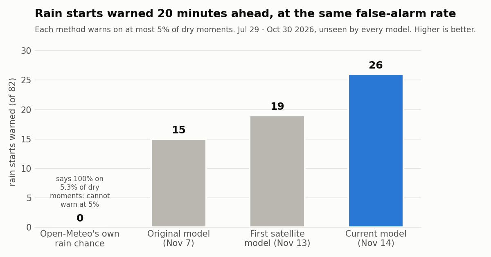
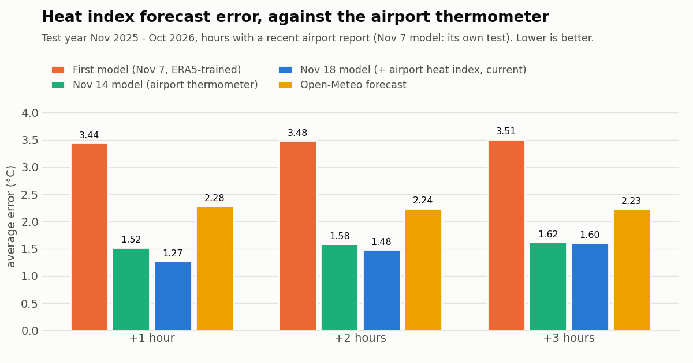

# ARNode: campus wayfinding with weather-aware routes

ARNode helps students and visitors find buildings, offices and rooms on college campuses. It runs in the phone's browser and can be installed like an app. It gives walking directions on a 2D map, in 3D or in AR (through the camera), works offline after one online visit, and steers people toward covered paths when rain is likely and toward shade when it is hot. Staff keep the map up to date in an admin console.

*AR-Node: Weather AI Prediction, Offline AR Wayfinding and Routes for Campuses (Pre-Mapped Nodes).*

**Last checked against the code:** 2026-11-15.

---

## Who can do what

**Admins** (admin console at `/admin`)
- Manage buildings: label them from the base map or draw them; edit name, short name, floors, height and status; move, reshape or remove them.
- Assign a building to a department, or hand it over to another department. Its rooms and routes stay where they are, and the new department manages them.
- Manage the doors of buildings that have no department.
- Manage campus areas (the Campus A and Campus B outlines).
- Manage roads and walkways, and lay route nodes along them automatically.
- Manage nodes anywhere, indoors and outdoors, on every floor: rooms and offices (destinations) and route nodes.
- Swap two offices: they trade names and departments and keep their spots.
- Manage every wall and every staircase between floors.
- Manage departments: create, rename, recolour, delete.
- Manage staff accounts: create admins and faculty, assign departments, change roles, remove accounts. Nobody can remove or demote themselves, and at least one admin always remains.
- Manage student accounts: add, edit, reset a password (gives a one-time temporary password), remove.
- Open the Weather Dashboard (prediction history and accuracy) and update the weather now.

**Faculty staff** (admin console at `/admin`; an admin must assign them a department first)
- Add, edit, move and remove nodes (rooms, offices, route nodes) only inside their own department's buildings and on those buildings' floors, including nodes other people placed there.
- Cannot add or edit nodes outside buildings. They can see the outdoor network, which admins manage.
- Edit their own department's buildings: move, reshape, rename, change floors and height, place doors. They cannot add, remove or reassign buildings.
- Draw walls, and edit or remove only the walls they drew.
- Add staircases between their own nodes, or from one of their nodes to an outdoor node.
- Preview a route to any destination they can see, and print QR codes for nodes.
- Cannot open the Weather Dashboard, Departments & accounts, or Students.

**Students** (`/map`, signed in with their school ID or school email)
- See the full campus map: buildings, offices, rooms and floors.
- Search for a destination and get walking directions, worked out on the phone, including stairs between floors and building doors.
- Directions go around walls and buildings, prefer sheltered paths when rain is likely, and avoid exposed paths while it rains or in heat mode.
- See the weather in one pill at the bottom of the map (what routing is doing right now); tap it for the details: chance of rain in the next 20 minutes and within the next hour, the heat index now and 1 to 3 hours ahead, and the UV index (sunburn risk). When no route is possible, the message says whether rain or heat closed the open-air paths.
- Tap **"It's raining here"** (in the weather pill's details) when rain starts. When two or more students report rain within 15 minutes, everyone's routes switch to covered paths straight away, before any forecast or airport report notices.
- Follow the route on the 2D map, in 3D, or in AR (camera view). Tap **Voice** on the direction card to hear each new direction spoken, just the direction ("Turn right.", "You have arrived at …"), so it stays short while walking. It uses the phone's own voices, so it also works offline.
- Scan a QR code on campus to set their position when GPS is weak.
- Install ARNode on the home screen. After one online visit, the map, search and directions also work offline.
- Change their own password (required after an admin reset).

**Visitors** (`/map`, "View as visitor", no sign-in)
- See building locations, building names and campus areas only.
- No rooms, offices or directions.

---

## How it works, in plain words

1. **The map is made of nodes.** Staff place nodes in the admin console: *rooms and offices* (places people look for) and *route nodes* (points along walkways and corridors). Walls, buildings and doors tell the router where people cannot walk. Staircases join floors.
2. **The phone plans the route.** When a student picks a destination, the phone links nearby nodes into a walking network and finds the shortest walk. Nothing is sent to the server, so directions also work offline.
3. **The phone keeps a copy.** After signing in once online, the map is saved on the phone and refreshed every 20 minutes and whenever the phone comes back online.
4. **The server watches the weather.** Every 10 minutes it reads the forecast (Open-Meteo), the nearest airport report (Zamboanga, RPMZ) and, if the trained model uses it, Himawari satellite images of cloud tops over campus. Small AI models turn these into a chance of rain in the next 20 minutes and within the next hour. When rain is likely, open-air paths cost more, so routes lean toward covered walkways. While it is raining (or dangerously hot), open-air paths are closed. Students who see rain start can tap "It's raining here", which switches routes for everyone once two people agree.
5. **If something is missing, the app still works.** No weather means normal routing; no satellite scan means the model's simpler version is used; no network means the saved map is used.

---

## Getting started (developers)

Needs PHP 8.3+, Composer, Node 18+, PostgreSQL (tests use SQLite in memory), and Python 3.11+ only for the ML tools.

```bash
composer setup              # install, .env, key, migrate, npm install, build
npm run dev                 # php artisan serve --port=8005 and vite --port=5173 together
php artisan schedule:work   # weather every 10 minutes, map every 20 (keep it running in development)
```

| Open | URL |
|---|---|
| Student map (development) | `http://localhost:5173/map` |
| Admin console (development) | `http://localhost:5173/` |
| After `npm run build` | `http://localhost:8005/map` and `http://localhost:8005/admin` |
| iPhone install check (a form for testers) | `/iphone-check` |

- The campus map tiles must exist at `storage/app/university.pmtiles`.

**Not in the repository (on purpose; see `.gitignore`), and how to get it back:**

| Left out | Why | Get it back |
|---|---|---|
| `vendor/`, `node_modules/` | dependencies | `composer install`, `npm ci` |
| `public/admin/`, `public/build/`, `public/sw.js` | build output | `npm run build` |
| `.env` and every `.env.*` except `.env.example` | secrets | copy `.env.example` to `.env`, then `php artisan key:generate` |
| `storage/app/university.pmtiles` | campus map tiles (large) | extract the campus area from a Protomaps build with the PMTiles tool, or copy it from the team's shared drive |
| `pmtiles.exe` | 59 MB tool | download from github.com/protomaps/go-pmtiles/releases |
| `ml/data/` (about 61 MB) | downloaded weather, airport and satellite history | the download buttons in `python ml/gui.py` (the satellite one takes hours) |
| `ml/reports/before-*/`, logs, live test runs | backups and personal runs | not needed |

The trained models (`ml/model.json`, `ml/model_h60.json`, `ml/heat_model.json`), their parity files and the evaluation reports (`ml/reports/metrics*.json`, `results*.csv`, `calibration*.png`, `heat_metrics.json`) **are** in the repository, so the app works without retraining.
- Vite forwards `/api`, `/sanctum` and `/university.pmtiles` to port 8005; keep the ports in `package.json` in step.
- **Demo accounts** (password `password`, never in production): admin `admin@campus.test`; staff `ccs.staff@campus.test` and `csm.staff@campus.test`; students `ae202401622`, `ae202502307`, `ae202300418`. Development builds show one-tap demo buttons; production builds only with `VITE_DEMO_ACCOUNTS=true`.
- **Testing on a phone** through an ngrok tunnel: put the tunnel host in `VITE_ALLOWED_HOSTS` and set `VITE_TUNNEL=ngrok` (skips ngrok's warning page). The app must be opened online once on each phone before it works offline.

### Tests

```bash
php artisan test --compact                  # 220 PHP tests
node --test src/*.test.mjs tests/*.test.mjs # 105 JavaScript tests (routing, walls, stairs, doors, rain, heat, UV)
python ml/test_satellite.py                 # satellite reader self-check
vendor/bin/pint --format agent              # format PHP after changes
```

---

## The weather AI

- **Rain model:** trained in `ml/train.py` on archived forecasts, airport reports and (optionally) satellite inputs. It answers "will it rain on campus in the next 20 minutes?", and routing follows this answer. A second model with the same inputs answers "will it rain at any time within the next hour?" (`ml/model_h60.json`, optional); the app shows that chance under the main line, for planning. The model type is a setting: a logistic regression (one weight per input, the default since Nov 2026: it scored better on the test months for both horizons and each prediction can be explained input by input) or gradient-boosted trees ("auto" keeps logistic unless the trees score at least 0.5% better on the validation months). Training then adds a calibration so the percentage means what it says (only if that helps on validation). It is only used if it beats every simpler method on a test period it never saw; otherwise the app uses the raw forecast. Training uses only steps labelled by the routine hourly airport report, because the extra reports the airport issues when the weather changes are almost always rain and would make the test look easier than real life.
- **How good it is (Nov 2026, scored on months the models never saw):** the 20-minute model warns before about 47% of rain starts while wrongly warning on about 10% of dry moments, and when it says 80-100% it rained 81% of the time; the 1-hour model warns before 49% of rain starts. Compared with the first campus model on the same unseen steps, it catches twice as many rain starts at the same false-alarm rate (18 instead of 9). It beats every simpler method by far (Brier score 0.035 against 0.263 for Open-Meteo's own rain chance). Limits: about half of rain starts are still missed (showers can form within minutes), most warnings end dry, and the truth used for scoring is the airport a few km away. The live record on the admin Weather Dashboard is the real-world check.
- **Heat model:** predicts the heat index 1, 2 and 3 hours ahead (`ml/train_heat.py`, write-up in `ml/HEAT_REPORT.md`). Since Nov 2026 it learns from the Zamboanga airport's thermometer, the same truth the live record uses (before, it learned from ERA5 reanalysis, which smooths out hot afternoons and made it read about 2.7 °C too cool). On the last 12 months it is off by about 1.5 °C on average with no bias, and beats every simpler method. It still underestimates the rare 40 °C+ hours.
- **Heat mode** (open-air paths closed) turns on when the heat index *now* is above 40 °C. A prediction never closes paths ahead of time: if the last update predicted over 40 °C for, say, 1 pm, the phone closes them once 1 pm arrives, until the next update decides from the new reading.
- **Satellite (optional):** `ml/satellite.py` reads two Himawari-9 images around campus, about 12 minutes behind real time: infrared (how cold, and so how tall, the cloud tops are, and whether they grew colder over the last 10 and 20 minutes) and water vapour (whether a cloud reaches the upper air, the sign of a real storm cloud rather than a thin high one). History starts in 2024. Training compares the model with and without them and keeps satellite only if it clearly helps (at least 0.5% better on validation, with at least 12 months of history). In a Nov 2026 test on the same unseen months, the water-vapour image and 10-minute cooling let the model warn about more rain starts at the same number of false alarms (16 instead of 12 at 3.5% of dry moments warned). Extra forecast inputs (lifted index, convective inhibition, freezing level, humidity aloft) were tested too and did not help, so they are not used.
- **"Raining now"** comes, in this order, from students' **"It's raining here"** reports (at least 2 different people within 15 minutes), the airport report when it is less than 75 minutes old, otherwise the forecast. Reports only ever turn rain on: a wrong "raining" sends people under cover, a wrong "dry" could send them into the rain. Each person can report once every 5 minutes. Reports are kept 180 days as campus-level ground truth for checking (and later training) the rain model.
- **UV index:** Open-Meteo's forecast UV index, shown from "moderate" (3) up. From "high" (6) routes prefer shade, more strongly up to "extreme" (11), the same way they do on hot days, so a clear but mild morning still steers students away from full sun.
- **Freshness:** the server refreshes every 10 minutes (the satellite's rhythm) and phones check every 5, so a new satellite image or airport report reaches students within about 15 minutes, and a rain report within 5.

### Benchmarks

Every method below is scored on months that **none** of the models trained or tuned on, against what the Zamboanga airport actually observed. Numbers measured in November 2026 (also in `ml/reports/benchmarks/benchmarks.json`).

**Rain, 20 minutes ahead.** The fairest test of "will students get a warning before the rain starts?": every method may wrongly warn on at most 5% of dry moments, and we count how many of the 82 rain starts (dry, then rain) it warned about.

<picture>
  <source media="(prefers-color-scheme: dark)" srcset="ml/reports/benchmarks/rain_benchmark_dark.png">
  
</picture>

| Method (Jul 29 - Oct 30 2026, 3,550 steps, 82 rain starts) | Rain starts warned at 5% false alarms | AUC (1 = perfect) | Brier score (lower is better) |
|---|---|---|---|
| Open-Meteo's own rain chance | 0 (it says 100% on 5.3% of dry moments) | 0.852 | 0.240 |
| Original campus model (Nov 7): forecast + airport + 9 models | 15 | 0.890 | 0.0298 |
| First satellite model (Nov 13): + cloud tops | 19 | 0.914 | 0.0296 |
| **Current model (Nov 14): + water vapour, 10-minute cooling, history from 2024** | **26** | **0.923** | **0.0293** |

The 1-hour model ("rain at any time within the next hour", test period Jun 26 - Oct 30 2026, 153 rain starts) warns before 49% of rain starts while wrongly warning on 10.8% of dry moments; AUC 0.916 and Brier 0.039, against 0.862 and 0.260 for Open-Meteo's own chance.

**Heat index, 1 to 3 hours ahead.** Average error against the airport thermometer over a full test year.

<picture>
  <source media="(prefers-color-scheme: dark)" srcset="ml/reports/benchmarks/heat_benchmark_dark.png">
  
</picture>

| Method (Nov 2025 - Oct 2026) | +1 h | +2 h | +3 h | Bias at +1 h |
|---|---|---|---|---|
| **Current model (trained on the airport thermometer)** | **1.50 °C** | **1.60 °C** | **1.64 °C** | **0.0 °C** |
| Typical value for that month and hour | 1.74 °C | 1.74 °C | 1.74 °C | −0.3 °C |
| Open-Meteo forecast heat index | 2.19 °C | 2.19 °C | 2.19 °C | −1.4 °C |
| Previous model (trained on ERA5 reanalysis) | 3.44 °C | 3.48 °C | 3.51 °C | −2.7 °C |

**Retraining** uses the training dashboard: `python ml/gui.py` (install packages once with `python -m pip install -r ml/requirements.txt`). In the Rain model section: 1 Download Open-Meteo, 2 Download METAR, 2b Download satellite (optional, many hours from 2024, resumable), 3 Train and evaluate (the 20-minute model), 3b Train 60-min model (optional). The Evaluation tab compares every input set, including the share of **rain starts** each one warned about. "Run parity check" proves the PHP app computes the same numbers as Python.

---

## Putting it online (production checklist)

- **Server:** PHP 8.3+ with `pdo_pgsql`, `mbstring`, `openssl`, `curl`, `xml`, `fileinfo`; PostgreSQL; Node 18+ to build. Python 3 only if `ml/model.json` has a `satellite` block (standard library only; set `WEATHER_PYTHON` if it is not called `python`). Without Python the app scores the model's fallback.
- **Environment (names only, never commit `.env`):** `APP_ENV=production`, `APP_DEBUG=false`, `APP_URL`, `APP_KEY`, `DB_*`, `FRONTEND_URL`, `STUDENT_EMAIL_DOMAIN`, `TRUSTED_PROXIES` behind a proxy, `WEATHER_*` as wanted. Sign-in tokens expire after 30 days by default (`SANCTUM_EXPIRATION` in minutes overrides it).
- **Build and deploy:** `composer install --no-dev --optimize-autoloader`, `npm ci && npm run build`, `php artisan migrate --force`, `php artisan storage:link`, copy `storage/app/university.pmtiles`, keep `ml/model.json`, `ml/model_h60.json` and `ml/heat_model.json`, then `php artisan config:cache && php artisan route:cache`.
- **Scheduler:** cron `* * * * * cd /path/to/app && php artisan schedule:run` (weather every 10 minutes, map every 20; expired tokens and old prediction history daily).
- **Check the build:** `grep -r "campus.test" public/admin` must find nothing (no demo accounts).
- **First admin** (seeders refuse to run in production): run `php artisan tinker` and enter
  ```php
  $u = new App\Models\User(['name' => 'Campus Admin', 'email' => 'admin@your-school.edu.ph']);
  $u->password = Illuminate\Support\Facades\Hash::make(readline('Password: '));
  $u->forceFill(['role' => 'admin'])->save();
  ```
  then create the other accounts in the admin console.

---

## Project status (against the Project Viability Assessment)

| Module | Status | Notes |
|---|---|---|
| 1. Positioning (GPS, map matching, compass, QR) | ✅ | Works online and offline. The ≥90% accuracy target is not measured yet. |
| 2. Search and routing (stairs, floors, doors) | ✅ | Routes are computed on the phone only. Lifts and ramps are not modelled. |
| 3. AR and 2D guidance | ✅ | AR uses the camera and compass; iOS has no WebXR, so AR there is the camera view. |
| 4. Admin node-mapping tool | ✅ | The 15-minute learnability test is not done yet. |
| 5. Map publishing and offline copy | ✅ | Installable app (service worker); map saved on the phone. |
| 6. Accounts and access control | ✅ | Admin, faculty, student, visitor. No per-room "restricted" flag yet. |
| 7. Security and safety | 🟡 | Hashed passwords, role checks, throttled sign-in, expiring tokens, a "look up from the screen" reminder in AR. Missing: privacy notice, screen wake lock. |
| 8. Weather AI and weather-aware routing | ✅ | Rain models (20 minutes and 1 hour), heat model, satellite, student rain reports, UV-aware shade routing. |
| 9. Usage statistics | ❌ | Not built. |

**Still to do:** privacy notice and consent (RA 10173), screen wake lock during navigation, usage statistics, measuring the objectives (GPS accuracy, AR arrow speed, admin training time, live weather accuracy after a few weeks), GSMaP_NOW rain data from JAXA (needs registration), floor-aware GPS map matching, the heat index "now" from the airport when its report is fresh (the forecast runs about 1.4 °C cool), and a view of student rain reports on the Weather Dashboard.
---

## Technical reference

### Stack

| Part | Technology |
|---|---|
| Backend | Laravel 13, PHP 8.3+ (developed on 8.5), Sanctum bearer tokens |
| Database | PostgreSQL (SQLite in memory for tests) |
| Frontend | React 18, Vite 5; two pages: `index.html` (admin console) and `map.html` (student map); built into `public/admin` |
| Maps | Leaflet 1.9 + protomaps-leaflet + a self-hosted PMTiles archive; optional Esri satellite imagery (online only) |
| 3D and AR | three.js 0.186, loaded only when a 3D view opens |
| ML | Python (pandas, scikit-learn) for training; models exported as JSON and scored in PHP |

### Main data

| Table | Holds |
|---|---|
| `users` | Admins, faculty (with a department) and students (school ID, course, year level). |
| `nodes` | Rooms, offices and route nodes: position, floor, `inside`/`outside`, building, department, who placed it. |
| `node_links` | Staircases between two nodes on different floors (slope, direction, flights, landing). |
| `borders` | Walls: points sharing a `group_id`; routes never cross them. |
| `buildings` | Outline, floors, height, status, doors, department. |
| `pathways` | Roads and walkways (drawn on the map; route nodes can be laid along them). |
| `campus_areas` | Named campus outlines. |
| `departments` | Name and label colour. |
| `weather_predictions` | Every 10-minute prediction and what the airport saw (kept 180 days). |
| `rain_reports` | "It's raining here" taps: who and when (kept 180 days). |

Foreign keys and the wall `group_id` are indexed. The public static file `/storage/data/map.json` holds buildings only; signed-in users get the full map from `GET /api/map-data`.

### API (`routes/api.php`)

- **Public:** `GET /api/map-data` (buildings only without a token, the full map with one), `GET /api/weather`, `POST /api/login`, `POST /api/student/login`. Sign-in counts only failed tries (10 a minute per account and address, 100 per address).
- **Students:** `GET /api/student/me`, `POST /api/student/password`, `POST /api/student/logout`, `POST /api/weather/rain-report` (any signed-in user; once every 5 minutes; replies with the updated weather state).
- **Staff (admin and faculty; rules per role in the controllers):** `nodes` (+ `POST /api/nodes/swap`), `node-links`, `borders` (+ `DELETE /api/borders/group/{id}`), `buildings`, `pathways` (+ `POST /api/pathways/{id}/route-nodes`), `campus-areas`, `departments`, `users`, `students` (+ `reset-password`), `GET /api/weather/history`, `POST /api/weather/refresh`.

### Routing rules (`src/pathfinding.js`)

- Walking links use a Gabriel graph on each floor: two nodes are linked if no other reachable node sits between them and the line crosses no wall. Staircases are the only links between floors.
- Labelled buildings (not "planned") are obstacles; with doors, routes enter only through them.
- Dijkstra picks the cheapest walk. In rain mode an open-air link costs more (`src/weatherCost.js`); on hot days or under a high UV index, sunny links cost more than shaded ones (`src/shadeRouting.js`). Distances and walking times shown to students stay real.

### Weather settings (`config/weather.php`)

Campus point, rain-mode thresholds, the rain penalty, how old weather may be before it is ignored (60 minutes), the airport station, the heat limits, the satellite switches (`WEATHER_USE_SATELLITE`, `WEATHER_PYTHON`, `WEATHER_SATELLITE_TIMEOUT`), the optional hour model (`WEATHER_HOUR_MODEL_PATH`, default `ml/model_h60.json`), and the rain reports rule (`WEATHER_REPORTS_MIN_PEOPLE` = 2, `WEATHER_REPORTS_WINDOW_MINUTES` = 15).

---

## Credits and licences

- Weather data by **Open-Meteo.com** (CC BY 4.0).
- Airport reports (METAR) from the **NOAA Aviation Weather Center** and the **Iowa Environmental Mesonet**.
- Satellite: **Himawari-8/9 data from the Japan Meteorological Agency (JMA), distributed by NOAA** (registry.opendata.aws/noaa-himawari).
- Map data © **OpenStreetMap** contributors; tiles by **Protomaps**; map library **Leaflet**.
- Optional satellite imagery: **Esri World Imagery** (free tier terms; attribution on screen).

---

## Notes for contributors and AI assistants

- Follow `CLAUDE.md`/`AGENTS.md` (Laravel Boost): match the conventions of neighbouring files, reuse existing components, no new dependencies without approval, prefer tests over one-off scripts.
- Keep this README current instead of adding new markdown files.
- Weather must never block routing. Routing rules live only on the phone; the server provides the weather state.
- Map content is entered only through the admin console (never seed fake coordinates); `created_by` is always set by the server.
- Do not add `React.StrictMode` to `main.jsx` or `mobile.jsx`: it mounts the camera, sensors and 3D renderer twice.
- Never commit `.env` or secrets.
